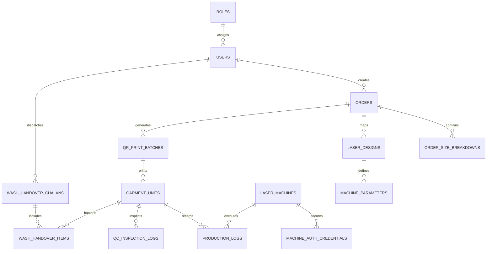

# একীভূত ডেটাবেজ আর্কিটেকচার ও ইআরডি স্পেসিফিকেশন (Consolidated Database Schema & ERD)
## ডেনিম লেজার অটোমেশন ও কন্ট্রোল সিস্টেম (Denim LACS)
**ডকুমেন্ট কোড:** `ARCH-LACS-DB-01`  
**সংস্করণ:** v1.0.0 (Master PostgreSQL 16 & UUIDv7 Schema)  
**অনুমোদনকারী কর্তৃপক্ষ:** Product Director / CTO (স্যার)  
**তারিখ:** নভেম্বর ২০২৬  

---

## ১. ডেটাবেজ কোর স্ট্যান্ডার্ডস ও নীতিমালা (Database Core Rules)

1. **প্রাইমারি কি (RFC 9562 UUIDv7)**: ডিস্ট্রিবিউটেড ২০টি মেশিনের অফলাইন সিঙ্ক এবং হাই-ভলিউম স্ক্যানিং কনফ্লিক্ট মুক্ত রাখতে সব টেবিলে টাইম-সর্টেড `UUIDv7` বাধ্যতামূলক।
2. **বাধ্যতামূলক অডিট কলাম (Audit Fields)**: প্রতিটি টেবিলে `created_at` (TIMESTAMPTZ), `updated_at` (TIMESTAMPTZ) এবং `is_deleted` (BOOLEAN Soft Delete) ফিল্ড থাকবে।
3. **ইনডেক্সিং পলিসি**: সমস্ত ফরেন কি (FK) কলামে এবং ঘন ঘন ফিল্টার হওয়া ফিল্ডে (`qr_code_hash`, `order_id`, `machine_id`, `status`) B-Tree ইনডেক্স বাধ্যতামূলক।
4. **নামকরণ কনভেনশন**: টেবিল ও কলামের নাম `snake_case` বহুবচন (Plural) হবে (যেমন: `orders`, `garment_units`)।

---

## ২. সামগ্রিক সিস্টেম ইআরডি রিলেশনশিপ (Entity Relationship Diagram)



---

## ৩. সম্পূর্ণ ২০+ টেবিলের প্রমিত DDL স্ক্রিপ্ট (PostgreSQL 16)

### ৩.১ সিকিউরিটি, ইউজার ও মেশিন ক্রেডেনশিয়ালস (Module: Auth)
```sql
CREATE TABLE roles (
    id UUID PRIMARY KEY, -- RFC 9562 UUIDv7
    name VARCHAR(50) UNIQUE NOT NULL, -- SUPER_ADMIN_CTO, LASER_DESIGNER, QC_INSPECTOR...
    display_name VARCHAR(100) NOT NULL,
    description TEXT,
    created_at TIMESTAMPTZ DEFAULT NOW(),
    updated_at TIMESTAMPTZ DEFAULT NOW(),
    is_deleted BOOLEAN DEFAULT FALSE
);

CREATE TABLE users (
    id UUID PRIMARY KEY,
    username VARCHAR(50) UNIQUE NOT NULL,
    email VARCHAR(100) UNIQUE NOT NULL,
    hashed_password VARCHAR(255) NOT NULL, -- Argon2id
    quick_pin_hash VARCHAR(255),          -- 4-Digit PIN Hash
    full_name VARCHAR(100) NOT NULL,
    employee_badge_id VARCHAR(50) UNIQUE, -- RFID / Badge ID
    role_id UUID NOT NULL REFERENCES roles(id) ON DELETE RESTRICT,
    is_active BOOLEAN DEFAULT TRUE,
    created_at TIMESTAMPTZ DEFAULT NOW(),
    updated_at TIMESTAMPTZ DEFAULT NOW(),
    is_deleted BOOLEAN DEFAULT FALSE
);
CREATE INDEX idx_users_role ON users(role_id);

CREATE TABLE laser_machines (
    id UUID PRIMARY KEY,
    machine_code VARCHAR(20) UNIQUE NOT NULL, -- M01 to M20
    name VARCHAR(100) NOT NULL,               -- Jeanologia Flat Conveyor #07
    ip_address VARCHAR(45) UNIQUE NOT NULL,   -- 192.168.1.107
    mac_address VARCHAR(50),
    is_active BOOLEAN DEFAULT TRUE,
    created_at TIMESTAMPTZ DEFAULT NOW(),
    updated_at TIMESTAMPTZ DEFAULT NOW(),
    is_deleted BOOLEAN DEFAULT FALSE
);

CREATE TABLE machine_auth_credentials (
    id UUID PRIMARY KEY,
    machine_id UUID NOT NULL REFERENCES laser_machines(id) ON DELETE CASCADE,
    api_token_hash VARCHAR(255) NOT NULL,
    allowed_ip_address VARCHAR(45) NOT NULL,
    last_heartbeat_at TIMESTAMPTZ,
    is_revoked BOOLEAN DEFAULT FALSE,
    created_at TIMESTAMPTZ DEFAULT NOW()
);
CREATE INDEX idx_mach_auth ON machine_auth_credentials(machine_id, is_revoked);
```

### ৩.২ অর্ডার ম্যানেজমেন্ট (Module: Orders - Step 1)
> 💡 **পর্যায়ভিত্তিক স্থাপত্য নোট:** ১ম পর্যায়ে সিস্টেম মোট অর্ডার কোয়ান্টিটি (`total_quantity`) দিয়ে পরিচালিত হবে। সাইজ ব্রেকডাউন ও ফাইল আপলোড রোডম্যাপ অনুযায়ী পরবর্তী পর্যায়ে সক্রিয় করা হবে।

```sql
CREATE TABLE orders (
    id UUID PRIMARY KEY,
    buyer_name VARCHAR(100) NOT NULL,         -- Levi's, H&M, Zara
    po_number VARCHAR(100) NOT NULL,          -- PO-884920
    style_code VARCHAR(100) NOT NULL,         -- Style 511 Slim
    fabric_composition VARCHAR(200),
    wash_reference VARCHAR(100) NOT NULL,     -- Dark Vintage Whisker
    total_quantity INT NOT NULL CHECK (total_quantity > 0),
    current_status VARCHAR(30) DEFAULT 'PENDING_DESIGN', -- PENDING_DESIGN, DESIGN_APPROVED, IN_PRODUCTION, COMPLETED
    target_delivery_date DATE NOT NULL,
    created_by UUID NOT NULL REFERENCES users(id),
    created_at TIMESTAMPTZ DEFAULT NOW(),
    updated_at TIMESTAMPTZ DEFAULT NOW(),
    is_deleted BOOLEAN DEFAULT FALSE,
    CONSTRAINT uq_po_style UNIQUE(po_number, style_code)
);
CREATE INDEX idx_orders_po ON orders(po_number);
CREATE INDEX idx_orders_buyer ON orders(buyer_name);
CREATE INDEX idx_orders_status ON orders(current_status);

-- [ভবিষ্যৎ সম্প্রসারণ রোডম্যাপ - Future Phase Expansion]
-- CREATE TABLE order_size_breakdowns (
--     id UUID PRIMARY KEY,
--     order_id UUID NOT NULL REFERENCES orders(id) ON DELETE CASCADE,
--     waist_size VARCHAR(20) NOT NULL,          -- W28, W30, W32, W34
--     order_quantity INT NOT NULL,
--     cut_quantity INT DEFAULT 0,
--     lasered_quantity INT DEFAULT 0,
--     qc_passed_quantity INT DEFAULT 0,
--     created_at TIMESTAMPTZ DEFAULT NOW(),
--     updated_at TIMESTAMPTZ DEFAULT NOW(),
--     is_deleted BOOLEAN DEFAULT FALSE,
--     CONSTRAINT uq_order_size UNIQUE(order_id, waist_size)
-- );
-- CREATE INDEX idx_order_size ON order_size_breakdowns(order_id);
```

### ৩.৩ লেজার ডিজাইন ভল্ট ও রেসিপি ম্যাপিং (Module: Laser Vault - Step 2)
```sql
CREATE TABLE laser_designs (
    id UUID PRIMARY KEY,
    order_id UUID NOT NULL REFERENCES orders(id) ON DELETE RESTRICT,
    waist_size VARCHAR(20) NOT NULL,
    design_type VARCHAR(30) NOT NULL,         -- COMPLETE_GARMENT, CUT_PANEL
    front_file_path VARCHAR(500) NOT NULL,    -- Vault Path: D:\LACS_VAULT\...\W32_Front.jean5
    front_file_hash VARCHAR(64) NOT NULL,     -- SHA-256 Checksum
    back_file_path VARCHAR(500),
    back_file_hash VARCHAR(64),
    is_locked BOOLEAN DEFAULT FALSE,
    locked_by UUID REFERENCES users(id),
    locked_at TIMESTAMPTZ,
    created_at TIMESTAMPTZ DEFAULT NOW(),
    updated_at TIMESTAMPTZ DEFAULT NOW(),
    is_deleted BOOLEAN DEFAULT FALSE,
    CONSTRAINT uq_order_size_design UNIQUE(order_id, waist_size, design_type)
);
CREATE INDEX idx_designs_order ON laser_designs(order_id, waist_size);

CREATE TABLE machine_parameters (
    id UUID PRIMARY KEY,
    laser_design_id UUID NOT NULL REFERENCES laser_designs(id) ON DELETE CASCADE,
    target_part VARCHAR(20) NOT NULL,         -- FRONT, BACK, POCKET
    laser_power_percent NUMERIC(5,2) NOT NULL,
    marking_speed_mms INT NOT NULL,
    frequency_khz INT NOT NULL,
    resolution_dpi INT NOT NULL,
    extra_parameters JSONB,                   -- Layer and offset metadata
    created_at TIMESTAMPTZ DEFAULT NOW(),
    updated_at TIMESTAMPTZ DEFAULT NOW(),
    is_deleted BOOLEAN DEFAULT FALSE
);
CREATE INDEX idx_mach_param ON machine_parameters(laser_design_id);
```

### ৩.৪ কিউআর প্রিন্ট ব্যাচ ও ইউনিট ট্র্যাকিং (Module: QR & Units - Step 3, 4, 5)
```sql
CREATE TABLE qr_print_batches (
    id UUID PRIMARY KEY,
    order_id UUID NOT NULL REFERENCES orders(id) ON DELETE RESTRICT,
    cut_lot_number VARCHAR(50) NOT NULL,
    waist_size VARCHAR(20) NOT NULL,
    quantity INT NOT NULL,
    printed_by UUID NOT NULL REFERENCES users(id),
    printer_ip VARCHAR(45) NOT NULL,
    created_at TIMESTAMPTZ DEFAULT NOW(),
    updated_at TIMESTAMPTZ DEFAULT NOW(),
    is_deleted BOOLEAN DEFAULT FALSE
);
CREATE INDEX idx_qr_batch ON qr_print_batches(order_id, cut_lot_number);

CREATE TABLE garment_units (
    id UUID PRIMARY KEY,
    qr_code_hash VARCHAR(64) UNIQUE NOT NULL, -- Encrypted QR String Payload
    order_id UUID NOT NULL REFERENCES orders(id) ON DELETE RESTRICT,
    waist_size VARCHAR(20) NOT NULL,
    cut_lot_number VARCHAR(50) NOT NULL,
    unit_serial_no INT NOT NULL,
    current_status VARCHAR(30) DEFAULT 'QR_PRINTED', -- QR_PRINTED, SEWING_ATTACHED, INTAKE_RECEIVED, LASER_COMPLETED, QC_PASSED, QC_REJECTED, RE_LASER, WASH_DISPATCHED
    trolley_number VARCHAR(50),
    created_at TIMESTAMPTZ DEFAULT NOW(),
    updated_at TIMESTAMPTZ DEFAULT NOW(),
    is_deleted BOOLEAN DEFAULT FALSE
);
CREATE INDEX idx_garment_qr ON garment_units(qr_code_hash);
CREATE INDEX idx_garment_order ON garment_units(order_id, current_status);
```

### ৩.৫ রিয়েল-টাইম প্রোডাকশন ও ওবিআই টেলিমেট্রি (Module: Production - Step 6, 7)
```sql
CREATE TABLE production_logs (
    id UUID PRIMARY KEY,
    garment_unit_id UUID NOT NULL REFERENCES garment_units(id) ON DELETE RESTRICT,
    machine_id UUID NOT NULL REFERENCES laser_machines(id) ON DELETE RESTRICT,
    order_id UUID NOT NULL REFERENCES orders(id) ON DELETE RESTRICT,
    waist_size VARCHAR(20) NOT NULL,
    front_cycle_seconds NUMERIC(5,2) NOT NULL,
    back_cycle_seconds NUMERIC(5,2) NOT NULL,
    total_cycle_seconds NUMERIC(5,2) NOT NULL,
    operator_code VARCHAR(50),
    shift_name VARCHAR(20) NOT NULL,           -- SHIFT_A, SHIFT_B, SHIFT_C
    completed_at TIMESTAMPTZ DEFAULT NOW(),
    created_at TIMESTAMPTZ DEFAULT NOW(),
    updated_at TIMESTAMPTZ DEFAULT NOW(),
    is_deleted BOOLEAN DEFAULT FALSE
);
CREATE INDEX idx_prod_mach ON production_logs(machine_id);
CREATE INDEX idx_prod_order ON production_logs(order_id);
CREATE INDEX idx_prod_completed ON production_logs(completed_at);

CREATE TABLE machine_downtime_logs (
    id UUID PRIMARY KEY,
    machine_id UUID NOT NULL REFERENCES laser_machines(id) ON DELETE CASCADE,
    start_time TIMESTAMPTZ NOT NULL,
    end_time TIMESTAMPTZ,
    duration_minutes NUMERIC(6,2),
    reason_code VARCHAR(50) DEFAULT 'NO_FEEDING', -- NO_FEEDING, OPERATOR_BREAK, BREAKDOWN, MAINTENANCE
    reported_by UUID REFERENCES users(id),
    created_at TIMESTAMPTZ DEFAULT NOW(),
    updated_at TIMESTAMPTZ DEFAULT NOW(),
    is_deleted BOOLEAN DEFAULT FALSE
);
CREATE INDEX idx_downtime_mach ON machine_downtime_logs(machine_id);
```

### ৩.৬ কোয়ালিটি অডিট ও ওয়াশ ড্রাম হ্যান্ডওভার (Module: QC & Wet Wash - Step 8)
```sql
CREATE TABLE qc_inspection_logs (
    id UUID PRIMARY KEY,
    garment_unit_id UUID NOT NULL REFERENCES garment_units(id) ON DELETE RESTRICT,
    inspector_id UUID NOT NULL REFERENCES users(id) ON DELETE RESTRICT,
    machine_id UUID NOT NULL REFERENCES laser_machines(id) ON DELETE RESTRICT,
    inspection_status VARCHAR(20) NOT NULL,    -- PASSED, RE_LASER, REJECTED
    defect_code VARCHAR(50),                  -- HEAVY_BURN, FAINT_PATTERN, ALIGNMENT_SHIFT, BURN_HOLE, DOUBLE_BURN
    defect_location VARCHAR(50),              -- FRONT_WHISKER, BACK_CHEVRON, POCKET, KNEE
    severity VARCHAR(20) DEFAULT 'MINOR',     -- MINOR, MAJOR, CRITICAL
    re_laser_power_offset_percent INT DEFAULT -20,
    created_at TIMESTAMPTZ DEFAULT NOW(),
    updated_at TIMESTAMPTZ DEFAULT NOW(),
    is_deleted BOOLEAN DEFAULT FALSE
);
CREATE INDEX idx_qc_garment ON qc_inspection_logs(garment_unit_id);
CREATE INDEX idx_qc_status ON qc_inspection_logs(inspection_status);

CREATE TABLE wash_handover_chalans (
    id UUID PRIMARY KEY,
    chalan_number VARCHAR(50) UNIQUE NOT NULL, -- CH-WASH-202611-0012
    order_id UUID NOT NULL REFERENCES orders(id) ON DELETE RESTRICT,
    trolley_number VARCHAR(50) NOT NULL,
    total_pieces INT NOT NULL,
    generated_by UUID NOT NULL REFERENCES users(id),
    received_by UUID REFERENCES users(id),
    status VARCHAR(30) DEFAULT 'DISPATCHED',  -- DISPATCHED, IN_TRANSIT, RECEIVED_AT_WASH
    dispatched_at TIMESTAMPTZ DEFAULT NOW(),
    received_at TIMESTAMPTZ,
    created_at TIMESTAMPTZ DEFAULT NOW(),
    updated_at TIMESTAMPTZ DEFAULT NOW(),
    is_deleted BOOLEAN DEFAULT FALSE
);
CREATE INDEX idx_wash_chalan_no ON wash_handover_chalans(chalan_number);

CREATE TABLE wash_handover_items (
    id UUID PRIMARY KEY,
    chalan_id UUID NOT NULL REFERENCES wash_handover_chalans(id) ON DELETE CASCADE,
    garment_unit_id UUID NOT NULL REFERENCES garment_units(id) ON DELETE RESTRICT,
    scanned_at TIMESTAMPTZ DEFAULT NOW()
);
CREATE INDEX idx_wash_items ON wash_handover_items(chalan_id, garment_unit_id);
```

---

এই একীভূত ডেটাবেজ স্কিমাটি সম্পূর্ণ ৮টি ধাপ, ইনফ্রাস্ট্রাকচার ও সিকিউরিটির সমস্ত রিলেশনশিপকে শতভাগ সংহত ও অপ্টিমাইজড করে তৈরি করা হয়েছে।

